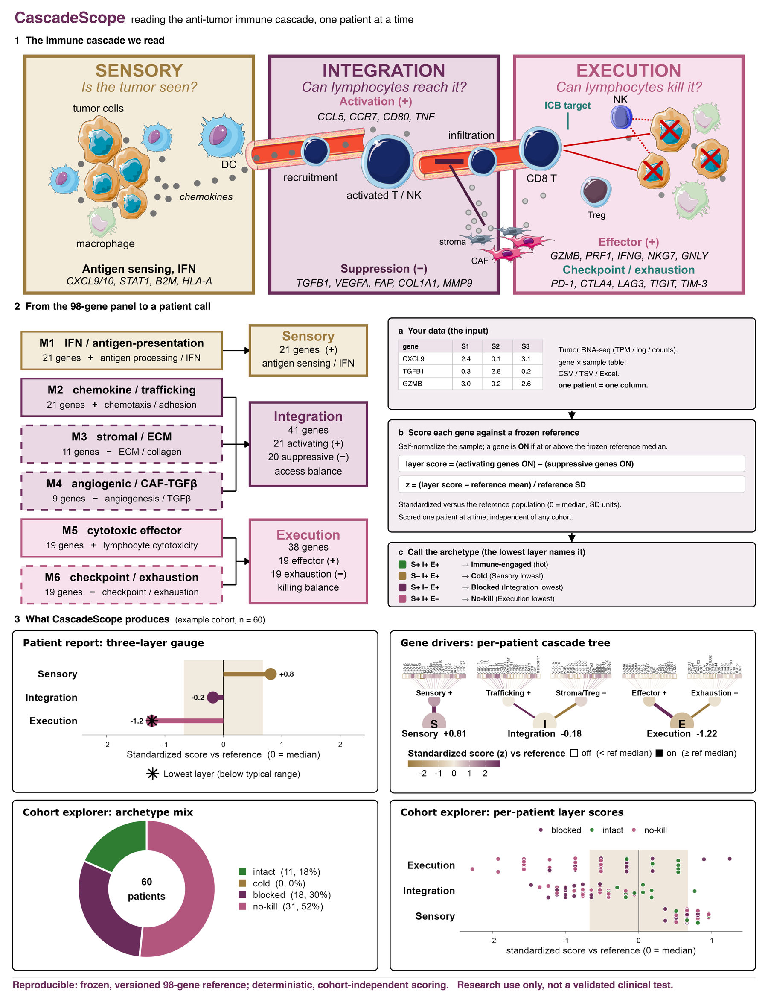

<p align="center">
  
</p>

<p align="center">
  <b>CascadeScope</b>: score tumor RNA against the <b>Immune Cascade Index (ICI)</b> and see
  <i>where immunity stalls</i>, one patient at a time.
</p>

<p align="center">
  <em>Research use only: investigational biomarker, not a validated clinical test.</em>
</p>

---

<p align="center">
  
</p>

## What this is

**CascadeScope** is the software; the **Immune Cascade Index (ICI)** is the method it implements.

- **Immune Cascade Index (ICI)** is the *science*: a 98-gene, three-layer transcriptomic framework
  for reading the anti-tumor immune response to checkpoint blockade, developed and validated in the
  manuscript.
- **CascadeScope** is the *software*: a self-contained R/Shiny app that computes and visualizes the
  ICI for a single patient (or a cohort), locally. Your data never leaves the machine.

The ICI reads the immune response as a three-stage **cascade** and scores each stage against a
frozen reference population:

| Layer | Biology | Question |
|-------|---------|----------|
| **Sensory** | antigen presentation, IFN signaling | is the tumor being *seen*? |
| **Integration** | T-cell trafficking vs stromal / Treg exclusion | do immune cells *get in*? |
| **Execution** | cytotoxic effector output (CD8 T **and** NK) vs exhaustion | do the cells that got in *kill*? |

Every score (layers, sub-modules, and individual genes) is reported on **one scale**: the
**standardized score versus the reference** (0 = reference median, in SD units). The lowest layer is
flagged for attention (it marks where the cascade reads weakest, **not** a proven causal bottleneck).

## How it works

The overview figure at the top walks through it end to end:

1. **Input:** a tumor RNA-seq gene × sample table (TPM, log-TPM, or counts).
2. **Score:** each gene is self-normalized within the sample and compared to a **frozen 98-gene
   reference**, so a single patient is scored **cohort-independently**.
3. **Cascade:** genes roll up into 5 sub-modules and 3 layers; each layer gets a standardized score
   vs the reference, and the lowest layer names the archetype (**intact · cold · blocked · no-kill**).
4. **Read-outs:** patient report, 98-gene cascade view, and cohort explorer, with PDF / CSV export.

## Features

- **Patient report:** the archetype call, a standardized-score gauge with the lowest layer starred,
  the cascade drill-down (which sub-module is furthest from the reference), the lowest-layer biology
  (investigational), and a one-page **PDF** export.
- **Gene drivers:** a per-patient **cascade tree** (98 genes → sub-modules → layers) and a
  side-by-side **layer-heatmap** view, each on its own scale.
- **Cohort explorer:** archetype proportions, layer-score distributions, a per-patient beeswarm
  (click a point or a table row to open that patient), and a cohort **PDF** report.
- **About:** the method, the scale, the archetypes, and the research-use-only notice.
- Colour-blind-safe palette by default (plus three alternatives); downloads in CSV / TSV / Excel.

## Install

Requires **R ≥ 4.1** (tested on R 4.5.1). From R, install the runtime packages (all on CRAN):

```r
install.packages(c("shiny", "bslib", "plotly", "DT",
                   "ggplot2", "patchwork", "readxl", "openxlsx"))
```

<details>
<summary>Versions this release was tested with</summary>

```
R 4.5.1
shiny 1.13.0 · bslib 0.10.0 · plotly 4.12.0 · DT 0.34.0 · ggplot2 4.0.2
patchwork 1.3.2 · readxl 1.4.5 · openxlsx 4.2.8.1
```
For an exact, locked environment use [`renv`](https://rstudio.github.io/renv/):
`renv::init()` then `renv::snapshot()`.
</details>

## Run

**One command** (installs anything missing, then launches):

```bash
Rscript run.R
```

Or from R, pointing at this folder:

```r
shiny::runApp("path/to/app")   # or shiny::runApp(".") from inside it
```

Click **Load example cohort** in the sidebar to try it immediately with the bundled public data
(no file needed).

## Input format

A **gene × sample** table: first column = gene symbol, remaining columns = samples.

- Formats: **CSV, TSV, or Excel** (`.xlsx` / `.xls`); the delimiter is auto-detected for text files.
- Values: **TPM, log-TPM, or counts**; linear data is auto-log2-transformed.
- A **single patient** is simply a one-column file.
- Coverage of the 98 panel genes is reported; gene **aliases / Ensembl IDs** are mapped automatically.

Download a ready-made template from the sidebar (**Download an input template**), or see
[`example_cohort.csv`](example_cohort.csv) (a public IMvigor210 subset, 60 samples).

## Reproducibility

- **Frozen reference.** Scoring is against a **locked** per-gene reference distribution shipped in
  [`references/ICI_v1.rds`](references/ICI_v1.rds). Given the same input, the output is **deterministic**.
- **Cohort-independent.** Each sample is self-normalized, so results do not depend on which other
  samples are in the file, so a single patient scores identically alone or in a cohort.
- **Versioned registry.** Every report is stamped with the panel/reference version, gene coverage,
  and build date. Drop a new `references/*.rds` in and it appears in the selector with no code change.
- **Self-contained.** This folder has everything needed to run (app code, scoring engine, frozen
  reference, example data, assets). No internet or external database is required at run time.

> `make_app_assets.R` documents how the frozen reference was built. It is **not** needed to run the
> app and cannot be re-run from this folder alone; it requires the reference cohort expression
> matrix and the panel definition (not distributed) plus Bioconductor's `org.Hs.eg.db`.

## Repository layout

```
app/
├── app.R                   UI + server (four tabs; reference registry; plot/report builders)
├── ici_locked_reference.R  scoring engine (freeze a reference; single-patient scoring)
├── score_cohort.R          preprocessing, score_uploaded(), per-gene / sub-module detail
├── run.R                   one-command launcher (installs deps, starts the app)
├── references/
│   └── ICI_v1.rds          frozen locked reference (per-gene distributions + panel + metadata)
├── example_cohort.csv      example upload (public IMvigor210 subset)
├── www/                    logo + favicon (icon.svg/png, logo.svg/png)
├── docs/architecture.svg   the "how it works" schematic (editable) + .png
├── README.md               this file
├── SHARING.md              how to share a running copy with colleagues (static bundle / shinyapps.io)
└── LICENSE                 MIT License
```

## Sharing

To give colleagues a link or a no-install copy (static in-browser bundle, or a hosted deployment),
see [`SHARING.md`](SHARING.md).

## Citing & license

If you use CascadeScope or the ICI, please cite the manuscript (citation to be added on publication).

Released under the [MIT License](LICENSE). The bundled example data is a public IMvigor210 subset.

## Research use only

CascadeScope is an **investigational** research tool. It is **not** a validated clinical test, does
not replace approved biomarkers (PD-L1, TMB, MSI) or clinical judgment, and its mechanistic rationale
is hypothesis-generating, not a treatment recommendation.
